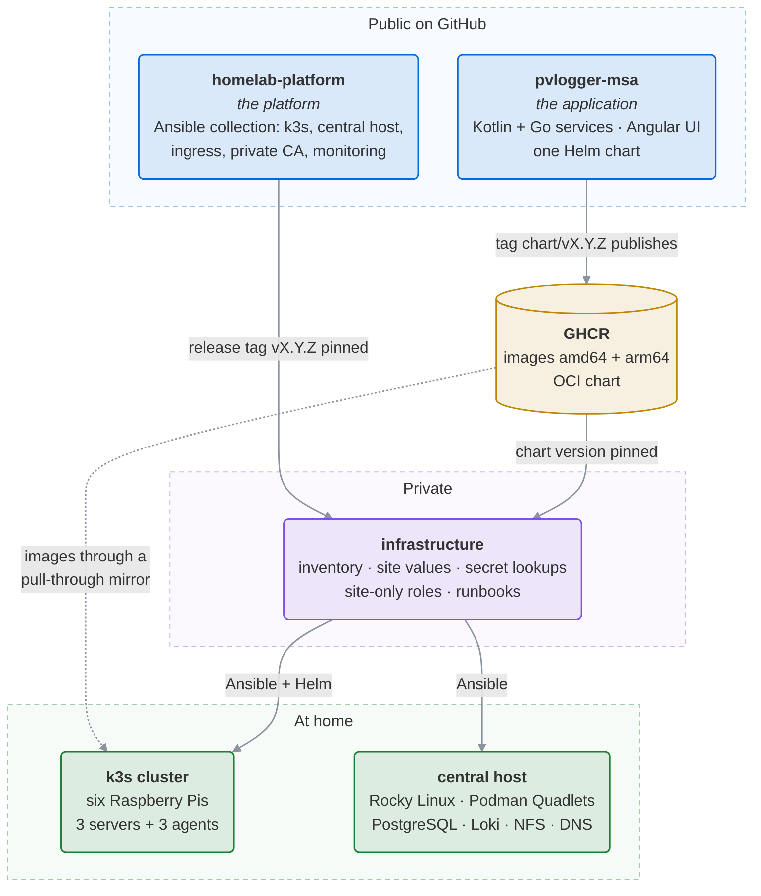

# Hi, I'm Bruno Ziswiler

Software engineer and ETH Zurich graduate, with experience across software engineering, DevSecOps, and project management. I build and operate a personal open-source platform that collects data from my photovoltaic system on Kubernetes.

This profile is mostly one project, in two public layers: a solar monitoring
application I wrote, and the homelab platform it runs on. Both are in
production at home, both are documented with the decisions behind them,
and both keep code public and site configuration private.

## The homelab, in three repositories

| Repository | Layer | What's in it |
|---|---|---|
| [**pvlogger-msa**](https://github.com/ziswb/pvlogger-msa) | Application | Monitoring for a home photovoltaic installation: Go collectors poll the inverters over Modbus TCP (implemented by hand, stdlib only), Kotlin/Ktor services store and serve the data, an Angular dashboard shows it live. Runs on a laptop with `tilt up` against a synthetic plant. |
| [**homelab-platform**](https://github.com/ziswb/homelab-platform) | Platform | Ansible collection `ziswb.homelab_platform`: k3s on Ubuntu nodes, a Rocky Linux central host running services as Podman Quadlets, MetalLB, Traefik, cert-manager with a private CA, CloudNativePG, Prometheus Operator, Loki and Alloy. Molecule-tested, released as SemVer tags. |
| *infrastructure* (private) | Site | Everything that identifies the site: inventory, addresses, secrets (1Password lookups), the other workloads' deployments, runbooks and post-mortems. It pins one release of each public repo. |

## How it's built

- **Public code, private configuration.** Site values exist only in the private repository; the public ones use placeholders and required variables. A leak guard (gitleaks rules in CI plus a private exact-value blocklist as git hooks) keeps it that way.
- **Decisions are written down.** Both public repositories carry their ADRs,
  backlogs and security findings, so the *why* is next to the code.
- **Releases are tags, consumers pin them.** One `chart/vX.Y.Z` tag publishes
  every PVLogger image and the chart; the platform ships as `vX.Y.Z` tags. The private repo upgrades by bumping a pin.
- **Tested against the real thing.** PostgreSQL in Testcontainers instead of an in-memory stand-in; Molecule on systemd containers for host roles; DST and time-zone edge cases as regression tests.
- **Built to survive a failing host.** The cluster keeps serving while the
  central host is down; a planned 75-minute shutdown confirmed it.
- **AI-assisted.** Much of the work was done with Claude Code as a pair
  programmer; each repository's `CLAUDE.md` holds its instructions, and co-written commits say so.

## What else runs on it

PVLogger is the reason the cluster exists, but not the only tenant. The private
repository deploys the rest on the same platform:

| Service | What for | Notes |
|---|---|---|
| [Immich](https://immich.app/) | Photo and video library | Own Helm chart; database on the central host's PostgreSQL with VectorChord |
| [Plex](https://www.plex.tv/) | Media server | Upstream chart; library on NFS from the central host |
| [Home Assistant](https://www.home-assistant.io/) | Home automation | |
| [Mealie](https://mealie.io/) | Recipes and meal planning | Database on the central host's PostgreSQL |
| [Pi-hole](https://pi-hole.net/) | Ad-blocking DNS for the LAN | Stateless, two replicas; local names forwarded to BIND |
| [UniFi OS Server](https://ui.com/) | Network controller | Podman on the central host, exposed through the cluster's ingress |

Each web UI gets a LAN ingress with a certificate from the private CA. The
router forwards no ports: the few services needed away from home are reachable
only over Tailscale.

## Backups: encrypted before they leave

- **One rule for what survives.** Everything durable lives in one tree on the
  central host. Databases are never copied as live files; they write dumps
  into the tree, and the dumps are what gets backed up.
- **Encrypted on the central host.** An hourly `rclone sync` goes through a
  crypt remote to a rented offsite storage box over SFTP, so file contents and
  names are encrypted before anything leaves the house. The provider sees only
  sizes and the shape of the tree. The keys are kept in a password manager
  and, in case that is lost in the same disaster, on paper.
- **Versions on two levels.** Anything an hourly run would delete or overwrite
  off-site is moved into a 30-day offsite trash instead, so every version that
  reached the offsite copy stays restorable. Behind that, the storage
  provider's daily snapshots, which the server's own credentials cannot
  delete, are the last resort.
- **A brake on mass deletion.** If a run would delete more files than a set
  cap (ransomware, an accident), it stops deleting off-site altogether:
  uploads continue, the trash is no longer pruned, and nothing more goes
  until someone has looked.
- **Checked, not assumed.** A monthly `rclone cryptcheck` compares checksums
  of the encrypted copy with the local data without downloading it.
  Prometheus alerts on a stale sync, a failed check, a tripped deletion cap
  and a filling storage box. Every restore path has been drilled.
